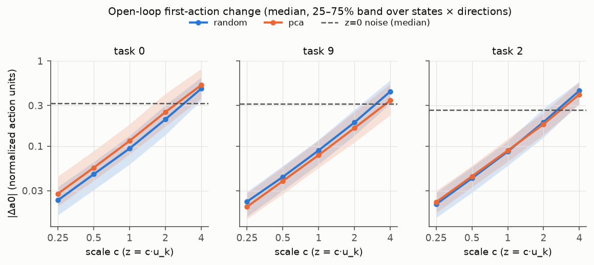
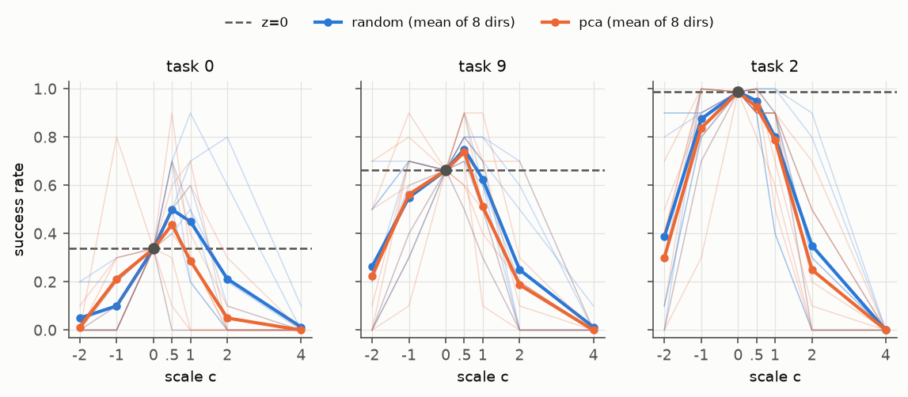
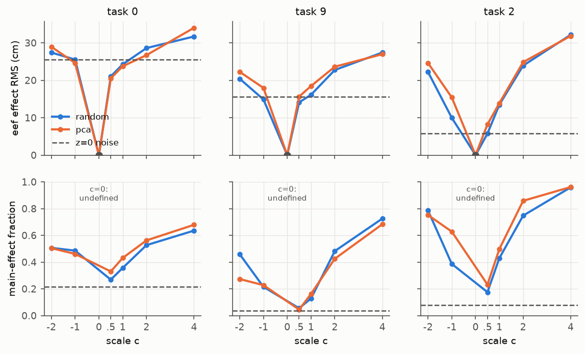
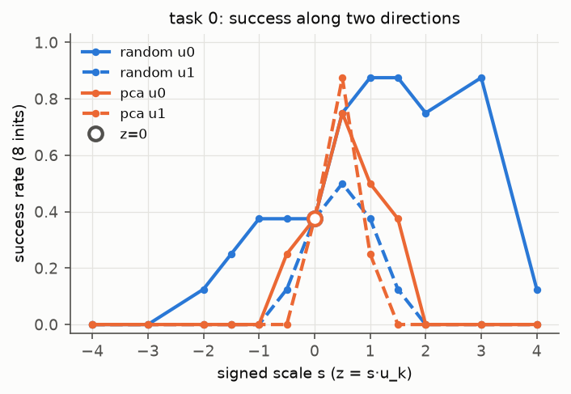
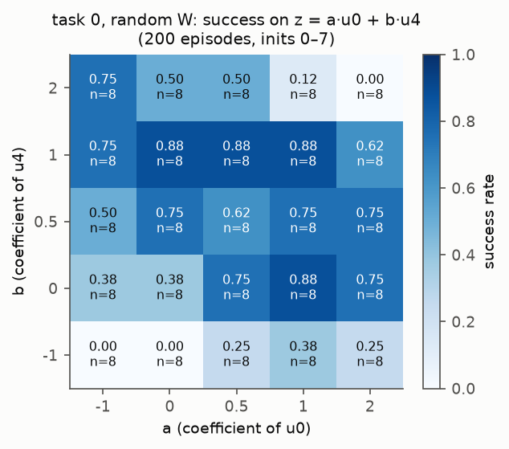
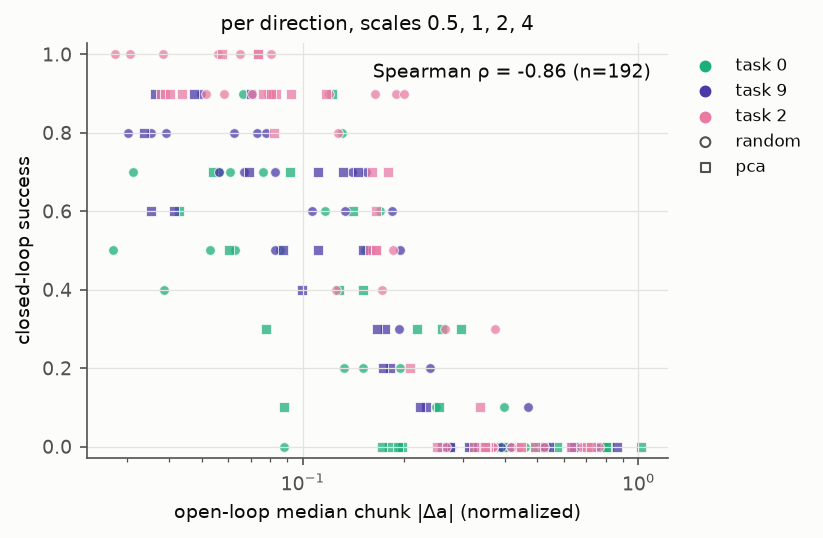
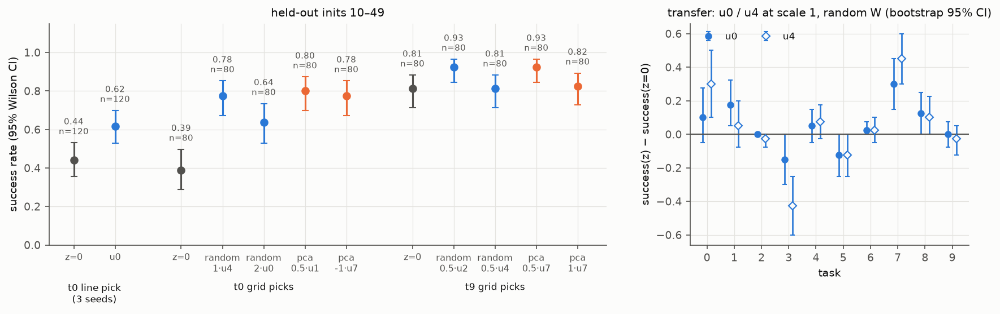
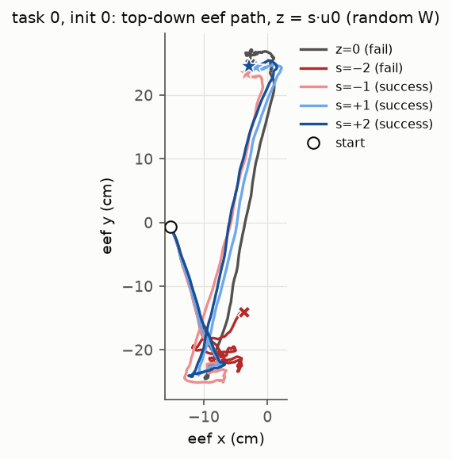

# SmolVLA z → FiLM steering on LIBERO-Object (minimal test)

Question: does a low-dim z injected as FiLM on the action expert act like a usable control
space (effect beyond policy noise, consistent across init states, smooth, reachable gains),
before any closed-loop optimization of z?

Setup: `HuggingFaceVLA/smolvla_libero`, `libero_object`, `expert_film` on expert MLP outputs of
layers 7,15,23,31, d=8, same γ/β for all denoising steps. Two W: `random` (Gaussian, γ and β,
α=0.3) and `pca` (top-8 PCs of each layer's MLP output over 24 default episodes of the same
task, β only, scaled by √λ, α=3.0). α is matched so the median open-loop |Δa0| at scale 1 is
≈0.1 (normalized action units) for both. z = scale·u_k, u_k ~ N(0, I8) (z_seed 0, the same 8
directions for every task and W). Flow-matching noise is seeded per (init, rep), so every z is
paired with the z=0 episode of the same noise; z=0 reruns are bit-identical across processes.
The policy replans every step (`n_action_steps=1`).

Code: `research/{run,openloop,openloop_summary,analyze}.py`; HPC `platforms/hpc/slurm/steer_{pair,lines}.sbatch`.
Raw outputs: `out/libero/smolvla/steer/` (local) and Sol `results/smolvla/steer/`.

## Baseline (z=0)

Local scan, 8 inits/task (`scan/`): tasks 0–9 = 3,7,8,8,6,8,7,3,8,5 /8 (63/80).
Chosen: t0 (low), t9 (mid), t2 (ceiling). HPC grid z=0 (inits 0–9 × 8 noise reps): t0 0.34,
t9 0.66, t2 0.99.

## Open-loop sensitivity (no sim; 96 saved policy inputs per task)

- Action noise is large: resampling flow noise at z=0 moves a0 by sd ≈ 0.29–0.35 (normalized).
- Median |Δa0| is linear in scale (random α=0.3: 0.023, 0.047, 0.094, 0.21, 0.47 at
  scale 0.25…4); below ~0.1·(this α) a bf16 rounding floor (~0.002) dominates.
- Heavy tails: in t0/t9 the 99th pct jumps to ~0.8 already at scale 0.5 (mode switches);
  t2 (unimodal) stays ≤0.24 at scale 1. PCA W has heavier tails at matched median.
- ∂a0/∂z per state: effective rank ≈ 4.3 of 7 (random), 3.9 (PCA); Jacobian consistency across
  states 0.22–0.5 random, 0.17 PCA (null ≈ 0.01): a z direction has a partly shared meaning.

## Closed-loop grid (HPC; scales −2,−1,0.5,1,2,4 × 8 dirs × inits 0–9)

Success (mean over 8 directions):

| task (z=0) | W | −2 | −1 | +0.5 | +1 | +2 | +4 |
| --- | --- | --- | --- | --- | --- | --- | --- |
| t0 (0.34) | random | 0.05 | 0.10 | 0.50 | 0.45 | 0.21 | 0.01 |
| t0 | pca | 0.01 | 0.21 | 0.44 | 0.29 | 0.05 | 0.00 |
| t9 (0.66) | random | 0.26 | 0.55 | 0.75 | 0.62 | 0.25 | 0.01 |
| t9 | pca | 0.23 | 0.56 | 0.74 | 0.51 | 0.19 | 0.00 |
| t2 (0.99) | random | 0.39 | 0.88 | 0.95 | 0.80 | 0.35 | 0.00 |
| t2 | pca | 0.30 | 0.84 | 0.93 | 0.79 | 0.25 | 0.00 |

(±c means are over different directions, so +1 vs −1 differences are direction sampling, not sign.)

Other metrics (`hpc/grid_metrics.json`, from `research/analyze.py`):
- Trajectory effect (eef xyz at steps 20…200, paired with z=0) vs noise effect (z=0 rep j vs
  rep 0): about equal at scale 0.5, larger from scale 1 (t2: 13.5 vs 5.8 cm).
- Main-effect fraction (share of the effect explained by the direction, consistent across
  inits): ≈ noise level at 0.5, 0.13–0.5 at 1, 0.5–0.96 at ≥2 (mostly shared failure modes).
- Overdispersion of per-direction success over binomial: 2–6 at |scale| 1–2 → directions differ
  reliably; there is structure to search over.
- Best-of-8 per init is uninformative: 8 noise reps at z=0 already reach 0.9–1.0.
- Closed-loop antisymmetry (cos of mean effects of +u, −u): ≈0 for random, −0.2…−0.56 for PCA at
  scale 1; positive at 2 (both signs fail the same way).
- Which directions are harmful is shared across tasks (same random W/U): corr of per-direction
  success at |s|=2 = 0.55–0.90 between tasks.
- Open-loop predicts closed-loop: per-direction median chunk |Δa| vs success, Spearman ρ =
  −0.6…−0.97 at scale 1–2 (pooled over tasks/W/scales ρ = −0.86).

## Smoothness: line scans on t0 (local, 2 directions × 12 scales × inits 0–7)

Success along z = s·u_k (z=0: 0.38):

| s | −4 | −3 | −2 | −1.5 | −1 | −0.5 | 0.5 | 1 | 1.5 | 2 | 3 | 4 |
| --- | --- | --- | --- | --- | --- | --- | --- | --- | --- | --- | --- | --- |
| random u0 | 0 | 0 | .12 | .25 | .38 | .38 | .75 | .88 | .88 | .75 | .88 | .12 |
| random u1 | 0 | 0 | 0 | 0 | 0 | .12 | .50 | .38 | .12 | 0 | 0 | 0 |
| pca u0 | 0 | 0 | 0 | 0 | 0 | .25 | .75 | .50 | .38 | 0 | 0 | 0 |
| pca u1 | 0 | 0 | 0 | 0 | 0 | 0 | .88 | .25 | 0 | 0 | 0 | 0 |

Unimodal along each line; random W has a wide plateau, PCA W a narrow window (|s| ≲ 1).

## Held-out validation (inits 10–49, unseen during selection)

- Line-scan pick, t0 random u0 (s=1), 3 noise seeds, n=120 paired: z=0 0.44 → 0.62,
  31 wins / 10 losses, sign test p=0.0015. 2·u0: 0.625 (seed 1000). −u1: 0.00 (0 wins / 20 losses).

- Grid picks (top-2 of 48 (dir, scale) per task/W by success on inits 0–9; `val/selection.json`),
  held-out inits 10–49 × 2 noise reps, n=80 paired with z=0:

| task | z=0 | W | pick (dir, s) | grid | held-out | wins/losses | sign p |
| --- | --- | --- | --- | --- | --- | --- | --- |
| t0 | 0.39 | random | 4, +1 | 0.9 | **0.78** | 36/5 | 8e-7 |
| t0 | | random | 0, +2 | 0.8 | 0.64 | 25/5 | 3e-4 |
| t0 | | pca | 1, +0.5 | 0.9 | **0.80** | 34/1 | 2e-9 |
| t0 | | pca | 7, −1 | 0.8 | 0.78 | 34/3 | 1e-7 |
| t9 | 0.81 | random | 2, +0.5 | 0.9 | **0.93** | 10/1 | 0.012 |
| t9 | | random | 4, +0.5 | 0.8 | 0.81 | 2/2 | 1 |
| t9 | | pca | 7, +0.5 | 0.9 | **0.93** | 10/1 | 0.012 |
| t9 | | pca | 7, +1 | 0.9 | 0.83 | 12/11 | 1 |

  One round of random search over z already finds gains that generalize to unseen inits and
  noise (t0 roughly doubles); in-sample grid numbers overestimate (winner's curse): the top
  pick holds everywhere, second picks only on t0. Both W reach the same level.

What the t0 picks change (held-out, from eef/gripper state): z=0 failures are mostly missed
grasps — 92% of failed episodes close the fingers on air (width < 1 cm) at least once; such
empty closes occur in 69% of all z=0 episodes vs 16% (random d4, +1) and 17% (PCA d1, +0.5).
(The 6 cm "closed" threshold in `analyze.py` is below the soup can's width, so its grasp-time
column is not meaningful for t0.)

## Cross-task transfer (random W; u0, u4 at s=1 picked on t0; inits 10–29 × 2 reps, n=40/task)

Same W and directions on every task, so a z found on t0 can be applied as is:

| task | 0 | 1 | 2 | 3 | 4 | 5 | 6 | 7 | 8 | 9 |
| --- | --- | --- | --- | --- | --- | --- | --- | --- | --- | --- |
| z=0 | .45 | .75 | 1.0 | .90 | .90 | .95 | .93 | .33 | .85 | .85 |
| u0 | .55 | .93 | 1.0 | .75 | .95 | .82 | .95 | .62 | .97 | .85 |
| u4 | .75 | .80 | .97 | .47 | .97 | .82 | .95 | .78 | .95 | .82 |

Paired over all tasks: u0 43 wins / 23 losses (p=0.019), u4 53/37 (p=0.11). t7 (the other low
task, never used for selection) gains most (u4 +18/−0); t3 is hurt (u4 −18/+1), t5 mildly.
Effects are partly task-general but a single z is not a universal improvement → task/context-
conditioned z is needed for a "policy adaptation" use.

Replication on t7 (local, random W): small grid (scales 0.5, 1 × 8 dirs × inits 0–7, z=0 0.44)
→ top-2 picks validated on inits 30–49 × 2 reps (n=40 paired): z=0 0.50 → d1 s=0.5 **0.75**
(11/1, p=0.006), d2 s=1 0.68 (13/6, p=0.17).

## Landscape: plane scan on t0 (random W, z = a·u0 + b·u4, inits 0–7, z=0: 0.38)

| a \ b | −1 | 0 | 0.5 | 1 | 2 |
| --- | --- | --- | --- | --- | --- |
| −1 | 0.00 | 0.38 | 0.50 | 0.75 | 0.75 |
| 0 | 0.00 | (0.38) | 0.75 | 0.88 | 0.50 |
| 0.5 | 0.25 | 0.75 | 0.62 | 0.88 | 0.50 |
| 1 | 0.38 | 0.88 | 0.75 | 0.88 | 0.12 |
| 2 | 0.25 | 0.75 | 0.75 | 0.62 | 0.00 |

A broad, smooth ridge (0.75–0.88 over a ∈ [0, 2], b ∈ [0.5, 1]) with failure toward b = −1 and
large |z|: friendly to local search / CEM with a norm bound.

## Style without failure (grid, successful episodes only)

t2 z=0 successful episodes take 122 ± 10 steps. At ~0.9 success, PCA dirs 0/4 give 107 steps at
s=+1 and 154/165 at s=−1 (monotone, sign-odd: a speed knob); across directions successful
episode length spans 101–185 steps. Random W directions change length less systematically.

Held-out check (t2, PCA, inits 10–29, paired, `val-t2-speed-pca`): z=0 1.00 success, 119 steps.
−u0 / −u4: 1.00 success, +29 / +32 steps (Wilcoxon p ≈ 9e-5); +u0 / +u4: 0.80 / 0.85 success,
−11 / −9 steps on episodes where both succeed (p = 0.007 / 0.04). Slowing is free, speeding up
costs success.

## Figures

Regenerate with `python -m research.plot_steer`.

- Open-loop dose: 
- Grid success: 
- Effect vs noise: 
- Line scans t0: 
- Plane scan t0 (u0, u4): 
- Open-loop vs closed-loop: 
- Held-out: 
- Example eef paths t0: 

## Takeaways

1. z → FiLM on the action expert is a real control space, not just noise: from |s| ≈ 1 the
   trajectory change exceeds flow-noise resampling, it is partly consistent across init states,
   directions differ reliably (overdispersion 2–6), and which directions are harmful is shared
   across tasks.
2. The usable region is a bounded ball. Success is an inverted U in |z|: s ≤ 1 (median open-loop
   |Δa0| ≲ 0.1, chunk |Δa| ≲ 0.15–0.2) is usable, s ≥ 2 mostly breaks the policy, s = 4 always.
   Open-loop chunk |Δa| predicts closed-loop failure (ρ ≈ −0.86) → a cheap, sim-free trust region
   or normalization for z before optimization.
3. Reachability/optimizability looks good: one round of random search over 48 candidates on 10
   inits gives held-out gains (t0 0.39 → 0.78–0.80, t9 0.81 → 0.93); success along lines and the
   2-D plane is unimodal and smooth. CEM over a norm-bounded z should be sample-efficient; the
   main risk is selection noise → score candidates with paired noise, several inits, and keep a
   held-out set.
4. Random vs PCA W: similar best-case gains. PCA has a narrower safe window (fails by |s| ≈ 1.5),
   heavier open-loop tails and a more sign-odd closed-loop response; its directions read more
   like knobs (validated speed knob on t2: slow +30 steps at no cost, fast −10 steps at −15–20%
   success). Random W has the wider plateau.
5. Evaluation for later optimization: paired-noise success on held-out inits (primary), paired
   effect/noise ratio and main-effect fraction (controllability), open-loop |Δa| (budget).
   Per-init best-of-K is useless here (8 noise reps at z=0 already reach 0.9–1.0).

Caveats: one W seed per scheme, d=8 and layers 7,15,23,31 fixed, libero_object only, grid on
10 inits; z=0 rates differ between laptop and Sol (e.g. t9 5/8 local vs 0.81 held-out on Sol),
so comparisons are always paired within one machine.
